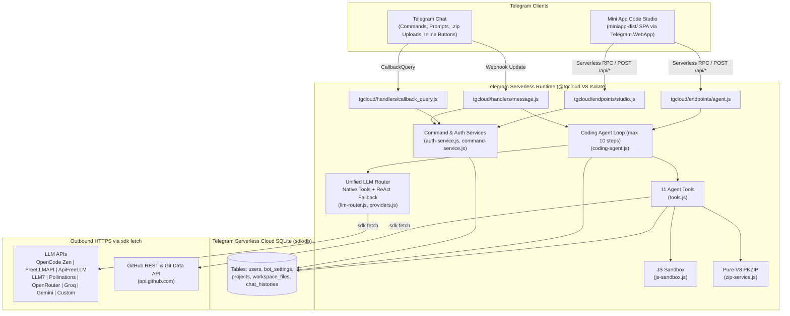

# Ahwaz — Telegram Serverless Coding Agent & Mini App Studio

Autonomous multi-provider AI coding agent and web-based Mini App Code Studio built natively for the **Telegram Serverless** runtime (`@tgcloud/cli`, V8 Isolates, and cloud SQLite).

[](./package.json)
[](./package.json)
[](https://core.telegram.org/bots/serverless)
[](./package.json)
[-6E9F18?logo=vitest&logoColor=white)](./tests)
[](https://t.me/webxplusx)

> **Language**: **English** | [فارسی (`README.fa.md`)](./README.fa.md)

---

## Overview

**Ahwaz** runs an iterative, tool-using software engineering agent directly inside Telegram's serverless infrastructure without requiring an external VPS, container, or external database. Every bot handler, Mini App RPC endpoint, PKZIP archiver, GitHub Git Data client, and multi-provider LLM router executes inside Telegram Serverless V8 isolates using only Web-standard APIs and the platform `sdk` (`db`, `api`, `fetch`, `InputFile`).

Users can manage isolated multi-file codebases persisted in SQLite, run up to 10 autonomous tool-calling steps per prompt, verify JavaScript logic in an isolated sandbox, import/export `.zip` archives in chat, synchronize repositories with GitHub, and edit files visually through the bundled **Telegram Mini App Code Studio**.

---

## Features

- **Native Telegram Serverless Architecture**: Zero runtime `node_modules` or Node.js built-ins inside `tgcloud/`. Validated statically via `scripts/validate-tgcloud.mjs`.
- **9 Built-In AI & Free LLM Providers**:
  - **OpenCode Zen (`opencode`)**: Curated free coding models (`big-pickle`, `deepseek-v4.1-flash-free`, `glm-5.3-flash-free`, `mimo-v2.6-flash-free`, `nemotron-3-ultra-free`, etc.) plus live catalog discovery from `GET https://opencode.ai/zen/v1/models`.
  - **FreeLLMAPI Router (`freellmapi`)**: Connects to any public HTTPS FreeLLMAPI `/v1` gateway (`auto`, `auto:smart`, `auto:fast`) and surfaces the upstream `x-routed-via` response header.
  - **ApiFreeLLM (`apifreellm`)**: Native REST adapter for `POST https://apifreellm.com/api/v1/chat`.
  - **Keyless Free Providers (`llm7`, `pollinations`)**: Zero-key operation out of the box with automatic failover from `api.llm7.io` to `text.pollinations.ai` on rate limits or upstream errors.
  - **OpenRouter (`openrouter`), Groq (`groq`), Google Gemini (`gemini`), and Custom OpenAI-Compatible APIs (`custom`)**.
- **Dual-Mode Tool-Calling Engine**:
  - Uses native function calling (`tools` / `tool_calls` for OpenAI-compatible APIs with automatic lowercase JSON Schema normalization; `functionDeclarations` with `thoughtSignature` preservation for Google Gemini).
  - Automatically falls back to a structured XML/JSON ReAct protocol (`<tool_call>...</tool_call>`) when a free model returns HTTP `400`/`404`/`422`/`501` for unsupported `tools`, or when using `apifreellm`.
- **Provider-Agnostic Conversation Memory**: Normalizes chat turns (`user`, `assistant`, `tool`) in SQLite (`chat_histories`, capped at 36 turns per project) so users can switch providers mid-project without breaking context.
- **11 Autonomous Coding Tools**:
  - Workspace CRUD & search: `list_files`, `read_file`, `write_file`, `edit_file`, `delete_path`, `search_code`
  - Code verification: `verify_javascript` (5-second timeout, `assert()` helper, captured `console` output)
  - Artifact delivery: `send_file_to_chat`, `export_project_zip` (pure-V8 IEEE 802.3 CRC32 + PKZIP builder/extractor supporting `STORE` and `DEFLATE`)
  - GitHub integration: `github_import_repo`, `github_push_project` via GitHub REST / Git Data API
- **Telegram Mini App Code Studio (`miniapp/`)**: Mobile-friendly SPA served directly by Telegram Serverless static hosting (`tgcloud.jsonc`), featuring an AI agent chat tab, file browser, code editor, project switcher, live OpenCode model sync, and provider credential configuration.

---

## Architecture



---

## Requirements / Prerequisites

- **Node.js**: `>= 18.0.0` (required by `@tgcloud/cli@^0.2.0` and local build/test scripts)
- **npm**: Included with Node.js (used to install local devDependencies `@tgcloud/cli` and `vitest`)
- **Telegram Bot & CLI Access Token**: Created via [`@BotFather`](https://t.me/BotFather) with **Telegram Serverless CLI Access** enabled (token format: `app<id>:<secret>`)
- **Optional External Credentials** (configured inside Telegram chat or Mini App after deployment):
  - Free or paid LLM API key (`OpenCode Zen`, `FreeLLMAPI`, `ApiFreeLLM`, `OpenRouter`, `Groq`, or `Google Gemini`) — *not required if using keyless `llm7` or `pollinations`*
  - GitHub Personal Access Token (`repo` / `contents:write` scope) — *only required for private repos or `/ghpush`*

---

## Quick Start

> **Important**: Always run `npm install` before running `npx tgcloud ...` commands so npm resolves the local `@tgcloud/cli` binary rather than an unrelated package on the registry.

### 1. Standard Setup (Linux, macOS, Windows)

```bash
# 1. Clone the repository and install devDependencies (@tgcloud/cli, vitest)
git clone https://github.com/gase99/Ahwaz.git
cd Ahwaz
npm install

# 2. Build the Mini App bundle, validate V8 isolate rules, and run tests
npm run build
npm run validate:tgcloud
npm test

# 3. Link the project to your bot using the @BotFather Serverless CLI Access token
npx tgcloud login

# 4. Deploy serverless modules + Mini App static assets, apply SQLite schema, and sync webhook
npm run deploy
npx tgcloud migrate
npx tgcloud webhook sync
```

### 2. Installing & Deploying from Android (Termux)

You can build, test, and deploy **Ahwaz** directly from an Android phone using **Termux**:

```bash
# 1. Update Termux packages and install Node.js LTS + Git
pkg update && pkg upgrade -y
pkg install -y nodejs-lts git

# Verify Node.js >= 18
node -v
npm -v

# 2. Clone the repository and install dependencies
git clone https://github.com/gase99/Ahwaz.git
cd Ahwaz
npm install

# 3. Build and verify locally
npm run build
npm run validate:tgcloud
npm test

# 4. Authenticate with your @BotFather CLI Access Token (app<id>:<secret>)
npx tgcloud login

# 5. Push code + Mini App to Telegram Serverless, run DB migrations, and sync webhook
npm run deploy
npx tgcloud migrate
npx tgcloud webhook sync
```

---

## Configuration

### 1. Local CLI & CI Environment Variables

Telegram Serverless V8 isolates (`tgcloud/**/*.js`) **do not have `process.env`**. Environment variables are used **only** on your local machine or CI runner by `@tgcloud/cli`:

| Variable / File | Scope | Format / Value | Description |
| :--- | :--- | :--- | :--- |
| `TGCLOUD_TOKEN` | Local CLI / CI | `app<id>:<secret>` | Non-interactive Telegram Serverless CLI Access Token. Overrides `.tgcloud/credentials` when set. |
| `TGCLOUD_ASSUME_TTY` | Local CLI / CI | `1` | Forces TTY mode in `@tgcloud/cli` commands (`login`, `push`, `migrate`) when `stdout.isTTY` is false. |
| `.tgcloud/credentials` | Local Machine | JSON (`0600`) | Created automatically by `npx tgcloud login` to store the bot's CLI Access Token locally (gitignored). |
| `tgcloud.jsonc` | Project Root | JSONC | Configures static Mini App hosting (`"source": "miniapp-dist"`, `"spa": true`). |

### 2. Runtime Secrets & Settings (Stored in Cloud SQLite)

All runtime API keys, URLs, and user permissions are stored inside Telegram Serverless SQLite (`users` and `bot_settings` tables in `tgcloud/schema.js`). When the bot **Admin** saves a provider key or GitHub token, it is also stored in `bot_settings` (`global_provider_configs`, `global_gemini_key`, `global_github_token`) as a shared fallback for authorized team members.

| Setting / Secret | SQLite Location | How to Configure | Required? |
| :--- | :--- | :--- | :---: |
| Active Provider & Model | `users.provider`, `users.model` | `/provider`, `/model`, `/opencode`, or Mini App topbar | Default: `opencode` / `big-pickle` |
| Provider API Keys & URLs | `users.provider_configs`, `bot_settings` (`global_provider_configs`) | `/opencode <key>`, `/freellm ...`, `/setkey [provider] <key>`, `/setcustom ...`, or Mini App `🔑` panel | Optional for `llm7` / `pollinations` |
| Google Gemini API Key | `users.gemini_key`, `bot_settings` (`global_gemini_key`) | `/setkey gemini <AIza...>` or `/setkey <AIza...>` | Only when using `gemini` |
| GitHub Personal Token | `users.github_token`, `bot_settings` (`global_github_token`) | `/setghtoken <ghp_...>` | Only for private repos or `/ghpush` |
| Mini App Studio URL | `bot_settings` (`mini_app_url`) | `/setminiapp <https://...>` (Admin only) | Optional (enables Mini App button) |

### 3. Supported LLM Providers (`tgcloud/lib/agent/providers.js`)

| Provider ID | Default Base URL / Endpoint | Protocol | Key Required? | Key Prefix Auto-Detect (`/setkey <key>`) | Default Model | Built-In Models |
| :--- | :--- | :--- | :---: | :--- | :--- | :--- |
| `opencode` | `https://opencode.ai/zen/v1` | `openai` | Optional* | Default fallback | `big-pickle` | `big-pickle`, `deepseek-v4.1-flash-free`, `deepseek-v4-flash-free`, `glm-5.3-flash-free`, `mimo-v2.6-flash-free`, `nemotron-3-ultra-free`, `nemotron-3.5-lightning-free`, `minimax-m2.5-free` (+ live `/models` sync) |
| `freellmapi` | *(User-defined HTTPS `/v1` URL)* | `openai` | Yes (+ URL) | `freellmapi-` | `auto` | `auto`, `auto:smart`, `auto:fast` |
| `apifreellm` | `https://apifreellm.com/api/v1/chat` | `apifreellm` | Yes | `apf_` or `apifreellm` | `apifreellm` | `apifreellm` |
| `llm7` | `https://api.llm7.io/v1` | `openai` | **No** (`unused`) | — | `default` | `default`, `gpt-oss`, `fast` |
| `pollinations` | `https://text.pollinations.ai` (`/openai`) | `openai` | **No** (`unused`) | — | `openai` | `openai` |
| `openrouter` | `https://openrouter.ai/api/v1` | `openai` | Yes | `sk-or-` | `qwen/qwen3-coder:free` | `qwen/qwen3-coder:free`, `deepseek/deepseek-chat:free`, `meta-llama/llama-3.3-70b-instruct:free` |
| `groq` | `https://api.groq.com/openai/v1` | `openai` | Yes | `gsk_` | `llama-3.3-70b-versatile` | `llama-3.3-70b-versatile`, `qwen-qwq-32b` |
| `gemini` | `https://generativelanguage.googleapis.com/v1beta` | `gemini` | Yes | `AIza` | `gemini-2.5-pro` | `gemini-2.5-pro`, `gemini-2.5-flash`, `gemini-2.0-flash` |
| `custom` | *(User-defined OpenAI-compatible URL)* | `openai` | Optional (+ URL) | — | `auto` | `auto` (or any custom model ID) |

*\*Note on `opencode`*: Uses a free API key from `https://opencode.ai/auth` (no credit card required). If invoked before a key is saved and `opencode.ai` returns `401`/`403`, `llm-router.js` automatically falls back to keyless `llm7` so initial prompts still succeed.

---

## CLI Commands

### 1. Project `npm` Scripts (`package.json`)

| Command | Underlying Script | Description |
| :--- | :--- | :--- |
| `npm run build` | `node miniapp/build.mjs` | Copies `miniapp/src/*` into `miniapp-dist/` for static deployment. |
| `npm run validate:tgcloud` | `node scripts/validate-tgcloud.mjs` | Verifies all `tgcloud/` modules obey V8 isolate, `.js` import, flat folder, and schema rules. |
| `npm test` | `vitest run` | Runs all 4 unit and end-to-end Vitest suites against mocked `sdk` and `sdk/db`. |
| `npm run deploy` | `npm run build && tgcloud push` | Builds `miniapp-dist/` and deploys all changed `tgcloud/` modules and static files. |
| `npm run push` | `tgcloud push` | Deploys `tgcloud/` modules and `miniapp-dist/` without rebuilding `miniapp/`. |
| `npm run migrate` | `tgcloud migrate` | Previews and applies pending SQLite schema changes from `tgcloud/schema.js`. |
| `npm run status` | `tgcloud status` | Shows local working tree changes relative to the `.tgcloud` snapshot (offline). |
| `npm run diff` | `tgcloud diff` | Shows line-by-line diffs against the `.tgcloud` snapshot (offline). |
| `npm run run -- <module> [args]` | `tgcloud run` | Executes a handler or endpoint in the cloud without deploying. |
| `npm run webhook` | `tgcloud webhook` | Displays cloud-managed webhook status (use `npx tgcloud webhook sync` to update). |

### 2. Direct `@tgcloud/cli` Commands

| Command | Description |
| :--- | :--- |
| `npx tgcloud login` | Interactively prompts for your `@BotFather` CLI Access Token (`app<id>:<secret>`) and saves it to `.tgcloud/credentials`. |
| `npx tgcloud webhook sync` | Points the Telegram bot webhook to Telegram Serverless and refreshes `allowed_updates` (`message`, `callback_query`). |
| `npx tgcloud pull` | Downloads the deployed cloud state into the local working directory and snapshot. |
| `npx tgcloud fetch` | Updates the local `.tgcloud` snapshot from the cloud without modifying local files. |
| `npx tgcloud reset [file]` | Restores local files from the `.tgcloud` snapshot. |

### 3. Telegram Bot Slash Commands (`tgcloud/lib/services/command-service.js`)

| Command | Access | Description |
| :--- | :--- | :--- |
| `/start`, `/help` | Allowed Users | Initializes the active project, registers the command menu (for Admin), and opens the main inline dashboard. |
| `/whoami` | Everyone | Displays your numeric Telegram ID (`tgId`) and current authorization status. |
| `/provider [id]` (or `/providers`) | Allowed Users | Opens the interactive provider switcher or switches directly to `<id>` (`opencode`, `llm7`, `freellmapi`, `gemini`, etc.). |
| `/opencode [api_key]` | Allowed Users | Without arguments: activates `opencode` and fetches live free models. With `<api_key>`: deletes the message and saves your OpenCode Zen key. |
| `/freellm <url_or_key> [key] [model]` | Allowed Users | Connects a **FreeLLMAPI** `/v1` router (when arg 1 starts with `http://` or `https://`) or saves an **ApiFreeLLM.com** key; auto-deletes message. |
| `/setkey [provider] <api_key>` | Allowed Users | Saves an API key for an explicit or prefix-detected provider and auto-deletes the chat message. |
| `/setcustom <base_url> [key] [model]` | Allowed Users | Configures and activates any custom OpenAI-compatible chat completions endpoint; auto-deletes message. |
| `/model [model_id]` (or `/models`) | Allowed Users | Opens the model selection menu for the active provider or sets an explicit `<model_id>`. |
| `/guide [provider_id]` (or `/connect`) | Allowed Users | Displays step-by-step connection instructions, commands, and signup links for one or all providers. |
| `/project [name]` (or `/projects`) | Allowed Users | Lists workspaces or creates/switches to project `<name>` (`^[a-zA-Z0-9][a-zA-Z0-9._-]{0,49}$`). |
| `/files` | Allowed Users | Lists up to 80 files and byte sizes in the active SQLite workspace. |
| `/cat <file_path>` | Allowed Users | Prints the contents of `<file_path>` (truncated safely at 3,500 characters). |
| `/zip` | Allowed Users | Packages the active workspace into `<project>.zip` in memory and sends it as a Telegram document. |
| `/ghclone <owner/repo> [branch]` | Allowed Users | Imports text source files from a GitHub repository into the active SQLite workspace. |
| `/ghpush <owner/repo> [commit_msg]` | Allowed Users | Commits and pushes all files in the active workspace to the project's configured branch (defaults to `main`) on GitHub. |
| `/setghtoken <ghp_token>` (or `/setgithub`) | Allowed Users | Saves a GitHub Personal Access Token and auto-deletes the message. |
| `/clear` | Allowed Users | Clears conversation history for the active project while keeping all workspace files intact. |
| `/status` | Allowed Users | Displays runtime platform info, active provider/model, file count, prompt/tool counters, and GitHub token state. |
| `/setminiapp <https://...>` | **Admin Only** | Saves the deployed Mini App HTTPS URL and adds the **Code Studio (Mini App)** WebApp button to `/start`. |
| `/allow <tg_id>` / `/revoke <tg_id>` | **Admin Only** | Grants or revokes bot and Mini App access for another Telegram user ID. |

---

## Telegram Bot Setup

### Step 1: Create the Bot & Obtain the CLI Access Token (`@BotFather`)
1. Open [`@BotFather`](https://t.me/BotFather) in Telegram and create a bot with `/newbot` (or select an existing bot via `/mybots`).
2. Navigate to **Your Bot → Serverless → CLI Access → Access token**.
3. Copy the token matching the format `app<id>:<secret>`. *(Note: `@tgcloud/cli` uses this Serverless CLI Access Token rather than the classic Bot HTTP token.)*

### Step 2: Link, Deploy, Migrate & Sync Webhook
```bash
npx tgcloud login          # Paste your app<id>:<secret> token
npm run deploy             # Builds miniapp-dist/ and uploads tgcloud/ + static files
npx tgcloud migrate        # Creates users, bot_settings, projects, workspace_files, chat_histories
npx tgcloud webhook sync   # Points webhook to Telegram Serverless
```
Take note of the `Static: https://...` URL printed at the end of `npm run deploy` (for example, `https://app<id>.tgcloud.ai/`).

### Step 3: Claim Admin Ownership
Open your bot in Telegram and send `/start`.
- In `tgcloud/lib/services/auth-service.js`, **the very first Telegram user ever recorded in the `users` table (`totalUsers === 0`) is automatically granted `isAdmin = true` and `isAllowed = true`**.
- All subsequent users default to `isAllowed = false` until the Admin authorizes them via `/allow <tg_id>` (users can check their ID with `/whoami`).

### Step 4: Configure AI Provider Keys (`/setkey`, `/opencode`, `/freellm`)
Choose any provider workflow in private chat with your bot (messages containing keys are automatically deleted):
- **Zero-Key Instant Start**:
  ```text
  /provider llm7
  ```
- **OpenCode Zen Free Coding Models** (get a free key at `https://opencode.ai/auth`):
  ```text
  /opencode YOUR_OPENCODE_KEY
  ```
- **Google Gemini / OpenRouter / Groq** (auto-detected by prefix or explicit provider name):
  ```text
  /setkey AIzaSyYourGoogleAiStudioKey
  /setkey openrouter sk-or-v1-your-key
  /setkey groq gsk_your_groq_key
  ```
- **FreeLLMAPI Router** (must be exposed over a public HTTPS URL so Telegram's cloud isolate can reach it):
  ```text
  /freellm https://router.example.com/v1 freellmapi-your-key auto:smart
  ```

### Step 5: Enable the Mini App Code Studio (`/setminiapp`)
Send the static URL returned during `npm run deploy` to your bot as Admin:
```text
/setminiapp https://app123456.tgcloud.ai/
```
Run `/start` again — the **Code Studio (Mini App)** WebApp button will appear at the top of the inline keyboard.

---

## Usage Examples

### 1. Build, Test, and Export a Project via Chat
```text
/project url-shortener
Write a pure ESM router and URL shortener utility in src/shortener.js, verify edge cases using verify_javascript, and send me the project ZIP.
```
The agent creates files in `workspace_files`, executes assertions in `js-sandbox.js`, packages `url-shortener.zip`, and uploads it directly into the chat.

### 2. Sync & Switch OpenCode Zen Live Free Models
```text
/opencode
```
Tap **`🔄 دریافت زنده مدل‌های رایگان از opencode.ai`** on the inline keyboard to query `GET https://opencode.ai/zen/v1/models`, filter active free models (`big-pickle`, `*-free`, `*:free`), and switch models in one tap.

### 3. Upload a `.zip` Archive for Refactoring
Attach any `.zip` archive (up to 15 MB) in Telegram chat with a caption:
```text
 Inspect the uploaded codebase, fix any bugs in src/parser.js, add unit assertions, and summarize what changed.
```
`handlers/message.js` downloads the file via `api.getFileContent()`, extracts text files into the active SQLite workspace (blocking path traversal and skipping binary/`node_modules`/`.git` paths), and runs the coding agent on the imported files.

### 4. Clone from GitHub, Edit, and Push Back
```text
/setghtoken ghp_YourPersonalAccessToken
/project my-service
/ghclone octocat/Hello-World main
Add an input validation helper in src/validate.js and update README.md.
/ghpush your-username/my-service feat: add input validation helper
```

---

## Project Structure

```text
Ahwaz/
├── AGENTS.md                         # Architecture & Telegram Serverless V8 isolate rules
├── README.md                         # Primary documentation (English)
├── README.fa.md                      # Persian documentation (فارسی)
├── package.json                      # Scripts & devDependencies (@tgcloud/cli, vitest)
├── tgcloud.jsonc                     # Telegram Serverless config (SPA static source: miniapp-dist)
├── vitest.config.js                  # Maps 'sdk' and 'sdk/db' to local test mocks
├── docs/
│   └── tgcloud-sdk.md                # Telegram Serverless SDK reference (db, api, fetch, endpoints)
├── scripts/
│   └── validate-tgcloud.mjs          # Static linter enforcing V8 isolate & schema constraints
├── miniapp/
│   ├── build.mjs                     # Copies miniapp/src/* into miniapp-dist/
│   └── src/
│       ├── index.html                # Mini App Code Studio layout (Agent, Files, Editor, Config)
│       ├── styles.css                # Telegram theme-aware responsive stylesheet
│       └── app.js                    # Frontend logic calling Telegram.WebApp.Serverless / /api/*
├── miniapp-dist/                     # Compiled static assets deployed by `tgcloud push`
├── tgcloud/                          # Deployed V8 isolate modules (zero npm/Node dependencies)
│   ├── schema.js                     # SQLite tables: users, bot_settings, projects, workspace_files, chat_histories
│   ├── handlers/                     # Flat Telegram Bot update handlers
│   │   ├── message.js                # Slash commands, text prompts, .zip & file uploads, live progress edits
│   │   └── callback_query.js         # Inline menus (providers, models, live OpenCode sync, projects, ZIP)
│   ├── endpoints/                    # Flat Mini App RPC endpoints (verified ctx.initData.user)
│   │   ├── agent.js                  # Runs coding agent prompts from Mini App Studio
│   │   └── studio.js                 # Workspace CRUD, project/provider/model switching, ZIP export
│   └── lib/
│       ├── agent/
│       │   ├── coding-agent.js       # 10-step autonomous agent loop & artifact collector
│       │   ├── js-sandbox.js         # Shadowed AsyncFunction evaluator with 5s timeout & assert()
│       │   ├── llm-router.js         # Gemini + OpenAI + ApiFreeLLM router & ReAct <tool_call> fallback
│       │   ├── providers.js          # 9 provider definitions, key inference & live OpenCode /models sync
│       │   ├── system-prompt.js      # Workspace-aware system prompt builder
│       │   └── tools.js              # 11 agent tool declarations & executors
│       └── services/
│           ├── auth-service.js       # First-user Admin bootstrap, allowlist & credential resolution
│           ├── binary-utils.js       # Pure-V8 UTF-8 & Base64 encoders/decoders
│           ├── command-service.js    # Slash command router & secret message auto-deletion
│           ├── conversation-service.js # Cross-provider chat history persistence & safe trimming
│           ├── delivery-service.js   # Markdown-to-Telegram-HTML formatter, chunker & InputFile sender
│           ├── github-service.js     # GitHub tarball/tree importer & Git Data API commit/push client
│           ├── keyboard-service.js   # Inline keyboard builders
│           ├── workspace-service.js  # SQLite virtual filesystem CRUD, regex search & path sanitization
│           └── zip-service.js        # Pure-V8 CRC32 + PKZIP builder & DEFLATE/STORE extractor
└── tests/
    ├── helpers/
    │   ├── mock-sdk.js               # Mocked sdk (api Proxy, fetch, InputFile, EndpointError)
    │   └── mock-sdk-db.js            # In-memory query-builder mock for sdk/db
    ├── coding-agent.test.js          # Multi-step Gemini tool calls, thoughtSignature & ZIP export tests
    ├── multi-provider-llm.test.js    # OpenCode Zen, ReAct fallback, FreeLLMAPI, ApiFreeLLM & LLM7 failover tests
    ├── serverless-handlers.test.js   # Admin bootstrap, allowlist, /setkey deletion & Mini App endpoint tests
    └── zip-and-delivery.test.js      # PKZIP round-trip, Zip-Slip rejection & HTML chunking tests
```

---

## Security Notes

- **First-User Admin Bootstrap & Allowlist**: The first user to interact with a freshly migrated database becomes Admin (`isAdmin = true`, `isAllowed = true`). Deploy and send `/start` immediately after running `npx tgcloud migrate` so no unauthorized user claims ownership first. All other users are blocked until explicitly approved via `/allow <tg_id>`.
- **Automatic Secret Message Deletion**: Slash commands carrying sensitive tokens (`/setkey`, `/opencode <key>`, `/freellm <args>`, `/setcustom`, `/setghtoken`) immediately invoke `api.deleteMessage` in `command-service.js` to remove credentials from chat history. Prefer running these commands in a **1-on-1 private chat** with the bot, where bots can delete messages or where no third parties can observe them briefly.
- **Header-Only API Key Transmission**: Outbound requests to Gemini (`x-goog-api-key`), OpenAI-compatible APIs (`Authorization: Bearer ...`), ApiFreeLLM, and GitHub send credentials strictly in HTTP headers, never in URL query parameters.
- **Admin Credential Inheritance**: Be aware that when an **Admin** (`isAdmin = true`) saves a provider API key or GitHub token, `auth-service.js` also stores it as the global fallback in `bot_settings` so users granted access via `/allow` can use the bot without configuring separate keys. Only `/allow` trusted collaborators if you store admin-level keys.
- **Verified Mini App RPC**: `tgcloud/endpoints/agent.js` and `tgcloud/endpoints/studio.js` rely on `ctx.initData.user`, which is cryptographically verified by the Telegram Serverless platform before the endpoint executes, and enforce `isAdmin || isAllowed`.
- **Zip-Slip & Path Traversal Protection**: `sanitizeFilePath()` and `extractZipBytes()` reject `..`, `.`, control characters, paths deeper than 16 segments, uploads over 15 MB, individual archive entries over 1.5 MB, and binary files containing null bytes.
- **JavaScript Sandbox Scope**: `verify_javascript` executes snippets via `AsyncFunction` with `fetch` and `globalThis` shadowed to `undefined` and a 5-second timeout, inside Telegram's V8 isolate. It is designed for deterministic algorithm verification rather than untrusted multi-tenant isolation—keep bot access restricted via `/allow`.
- **Local CLI Credentials**: `.tgcloud/credentials` (mode `0600`) and `.env` are excluded via `.gitignore`. Never commit `.tgcloud/` to version control.

---

## Troubleshooting

| Symptom / Error | Cause | Solution |
| :--- | :--- | :--- |
| `npx tgcloud` prints `A CLI tool for managing Telegram Cloud files` / `make-session` | `npx` downloaded the unrelated `tgcloud@0.1.0-canary.0` package because `node_modules` was not installed. | Run `npm install` in the repo root first so `npx tgcloud` uses `./node_modules/.bin/tgcloud` (`@tgcloud/cli@^0.2.0`). |
| `Schema out of sync` or SQLite table errors after deploy | `tgcloud push` uploads `schema.js` but intentionally never mutates the database automatically. | Run `npx tgcloud migrate` to apply pending table/column additions. |
| Bot does not respond to messages or button clicks in Telegram | Webhook or `allowed_updates` is not pointing to Telegram Serverless. | Run `npx tgcloud webhook` to inspect status, then run `npx tgcloud webhook sync`. |
| `npm run validate:tgcloud` fails after editing `tgcloud/` | A file inside `tgcloud/` used `Buffer`, `process.env`, a Node/npm import, a nested `handlers/`/`endpoints/` subfolder, `foreignKey()`, or omitted `.js` in a relative import. | Fix the flagged file according to `AGENTS.md` and re-run `npm run validate:tgcloud`. |
| `FreeLLMAPI` fails to connect to `http://localhost:3001/v1` | `tgcloud/` runs in Telegram's cloud V8 isolate, not on your local machine. | Expose your self-hosted FreeLLMAPI instance over a public HTTPS URL (VPS, cloud deploy, or Cloudflare Tunnel) and pass that HTTPS URL to `/freellm`. |
| OpenCode reply includes a note that it ran via `llm7` fallback | No OpenCode Zen key was saved yet and `opencode.ai/zen/v1` returned `401`/`403` for anonymous access. | Claim a free API key at `https://opencode.ai/auth` and run `/opencode YOUR_KEY`. |
| Mini App opens with `UNAUTHORIZED` (`401` / `EndpointError`) | Opened the static URL directly in an external browser instead of inside Telegram. | Launch the Mini App via the **Code Studio (Mini App)** WebApp button inside Telegram so `Telegram.WebApp.initData` is attached. |

---

## FAQ

**1. Can I use Ahwaz completely for free without registering any API key?**  
Yes. Run `/provider llm7` or `/provider pollinations` in chat. Both providers work without an API key, and `llm7` automatically fails over to `pollinations` if rate-limited.

**2. How do Free models without native OpenAI function-calling still create and ZIP files?**  
When a model returns HTTP `400`/`404`/`422`/`501` indicating `tools` are unsupported—or when `apifreellm` is selected—`llm-router.js` automatically retries the turn using a prompt-based `<tool_call>{"name": "...", "args": {...}}</tool_call>` ReAct protocol and feeds `<tool_result>` blocks back into the loop.

**3. Can I switch between Gemini, OpenCode Zen, and FreeLLMAPI in the middle of a project?**  
Yes. Both workspace files (`workspace_files`) and normalized conversation turns (`chat_histories`) are stored in SQLite independently of the active provider.

**4. Can `verify_javascript` run npm packages or shell commands like `git` or `python`?**  
No. Telegram Serverless executes in a pure V8 isolate without POSIX shells or filesystem binaries. `verify_javascript` evaluates pure ES/JavaScript logic and `assert()` checks, while GitHub operations use GitHub's HTTPS REST & Git Data APIs (`github-service.js`).

---

## Contributing

1. Fork the repository and create a feature branch from `main`.
2. Read [`AGENTS.md`](./AGENTS.md) and [`docs/tgcloud-sdk.md`](./docs/tgcloud-sdk.md) before modifying anything under `tgcloud/`:
   - Keep `tgcloud/handlers/` and `tgcloud/endpoints/` flat.
   - Include `.js` extensions on all relative imports inside `tgcloud/`.
   - Never use Node.js built-ins (`fs`, `path`, `Buffer`, `process.env`) or foreign keys (`.references()`, `foreignKey()`) in `tgcloud/`.
3. Run the full verification suite before opening a Pull Request:
   ```bash
   npm run build
   npm run validate:tgcloud
   npm test
   ```

---

## Maintainer & Contact

- **Developer & Maintainer**: **Abbas Karoshad**
- **Telegram**: [@webxplusx](https://t.me/webxplusx)
- **Repository**: [github.com/gase99/Ahwaz](https://github.com/gase99/Ahwaz)

---

## Documentation & Repository TODOs

The following items are not yet defined in the codebase and are tracked for future releases:

- [ ] **Add an explicit `LICENSE` file and `package.json` `"license"` field** (currently `package.json` sets `"private": true` with no license specified).
- [ ] **Add a GitHub Actions CI workflow** (`.github/workflows/ci.yml`) to run `npm run build && npm run validate:tgcloud && npm test` automatically on pushes and pull requests.
- [ ] **Optional UI Localization (`en` / `fa`)**: bot chat replies and Mini App UI labels are currently written in Persian (`fa`); adding a language toggle would improve international usability.

---

## License

No explicit open-source license file (`LICENSE`) or `"license"` field in `package.json` is currently present in this repository. Under standard GitHub terms, all rights are reserved by the author (**Abbas Karoshad**) until a `LICENSE` file is added. For licensing inquiries or permissions, contact [@webxplusx](https://t.me/webxplusx) on Telegram.
